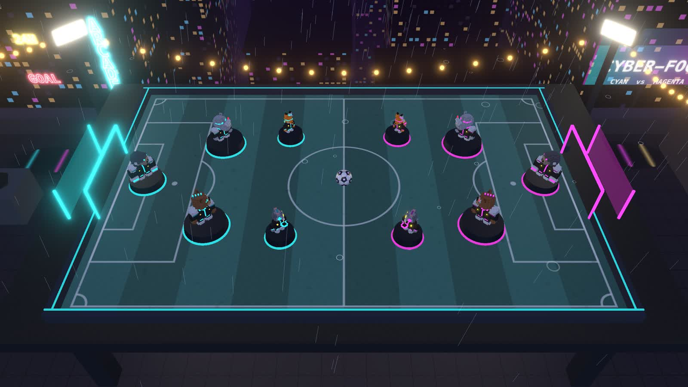

# cyber-foot

Table football on a rainy rooftop. Flick your pieces like a slingshot, knock the other team's over, score five goals before they do. Every player is a voxel animal in cyberpunk gear: a gorilla in goal, a rhino and a bear in defence, a fox and a cat up front.

**Play it: https://arimet.github.io/cyber-foot/**



## How to play

- Drag one of your pieces backwards and let go: the further you pull, the harder it goes.
- Choose the shot first: **along the ground**, or a **lob** that lifts the ball over the pieces in the way.
- The teams take one shot each, in turn. A piece hit hard enough falls over and sits out its team's next turn.
- First to 5 goals wins.
- Two players on one screen, or against the computer at three levels: Rookie, Pro and Legend.

It plays with a mouse or a finger, in French or English.

## Run it locally

```bash
npm install
npm run dev
```

`npm test` runs the tests, `npm run build` builds the static site into `dist/`.

Built with [Three.js](https://threejs.org/) for the rendering and [Rapier](https://rapier.rs/) for the physics. Everything in the game is drawn in code: no image or model files.

## License

MIT
